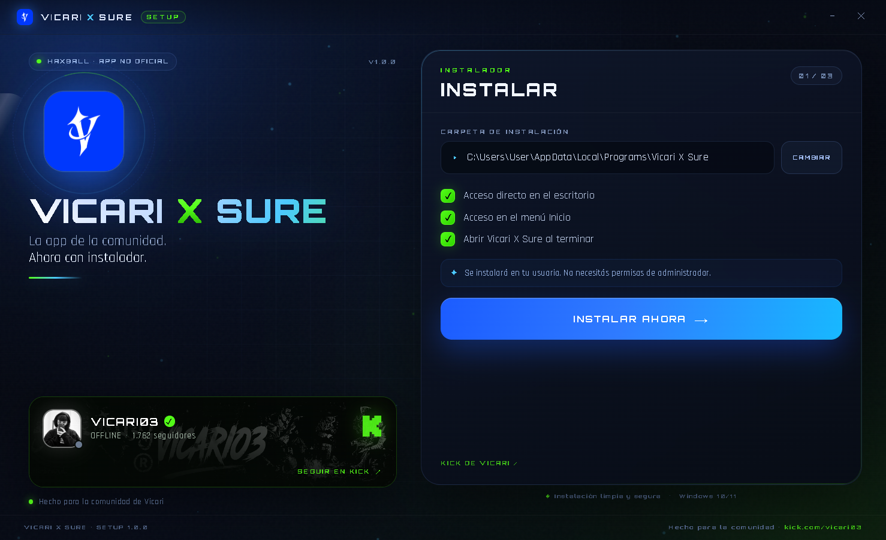
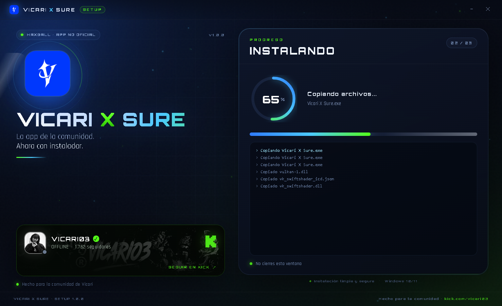

<p align="center">
  
</p>

<h1 align="center">VICARI X SURE</h1>

<p align="center">
  La app de la comunidad. Ahora con instalador.
</p>

<p align="center">
  <a href="https://github.com/suress10/vicari-x-sure/releases/latest">
    
  </a>
  <a href="https://kick.com/vicari03">
    
  </a>
</p>

> **Vicari X Sure** es una app para la comunidad de [Vicari](https://kick.com/vicari03). Incluye pelotas de Champions/Mundiales, 4 pisos (Lodo, Potrero, Parquet y Futurista) y una experiencia pensada para jugar HaxBall con la comunidad.

## Descargar

El instalador está en **[Releases](https://github.com/suress10/vicari-x-sure/releases/latest)**.

- **Archivo:** `Vicari-X-Sure-Setup.exe`
- **Tamaño:** ~110 MB
- **Sistema:** Windows 10/11 (64-bit)
- **Instalación:** por usuario, sin permisos de administrador

## Capturas

<p align="center">
  
  
</p>
<p align="center">
  
</p>

## Qué incluye

- Instalador propio con interfaz animada, sin wizard clásico.
- Tarjeta de Kick con avatar, banner, seguidores y estado live/offline de [vicari03](https://kick.com/vicari03).
- Instalación en `%LOCALAPPDATA%\Programs\Vicari X Sure`.
- Accesos directos en el escritorio y menú Inicio.
- Entrada en **Configuración > Aplicaciones** y desinstalador.
- Usa el mismo perfil `%APPDATA%\Vicari X Sure`: tus datos y configuración se conservan.
- La app mantiene su logo, su apodo/configuración y todas sus funciones.

## Instalación

1. Descargá `Vicari-X-Sure-Setup.exe` desde **Releases**.
2. Ejecutalo.
3. Si Windows SmartScreen muestra “Windows protegió tu PC”, entrá en **Más información > Ejecutar de todas formas**. El instalador no está firmado digitalmente.
4. Elegí la carpeta (o dejá la ruta por defecto) y hacé clic en **INSTALAR AHORA**.

## Desinstalar

- **Configuración > Aplicaciones > Vicari X Sure > Desinstalar**, o
- **Menú Inicio > Desinstalar Vicari X Sure**.

Tus datos y configuración se conservan.

## Verificación

SHA-256 del instalador:

```text
B1F5388E1DBA59621D886C29B11E70BB3C504A156A9E2066F5212346747696D1
```

## Comunidad

- Kick: [kick.com/vicari03](https://kick.com/vicari03)
- GitHub: [github.com/suress10](https://github.com/suress10)

---

Hecho para la comunidad de Vicari.  
Vicari X Sure no es una app oficial de HaxBall ni de Kick.
